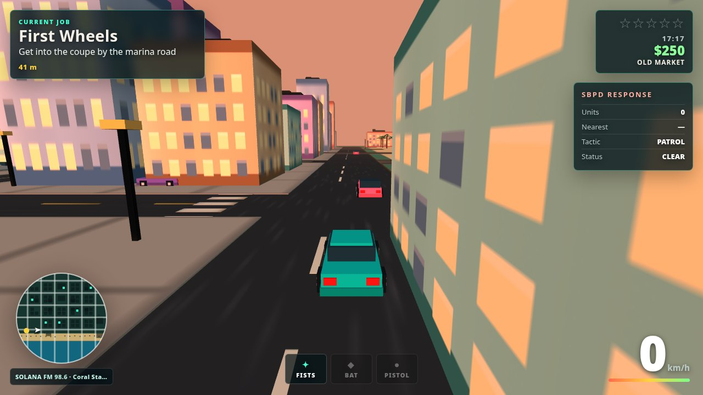
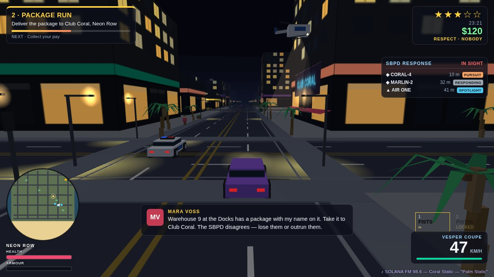

# HARBOR HEAT

[](https://make.fun/bounty/gta6-01?utm_source=github&utm_medium=readme&utm_campaign=gta6-01)
[](https://make.fun/bounty/gta6-01/leaderboard?utm_source=github&utm_medium=readme&utm_campaign=gta6-01)
[](https://make.fun/bounty/gta6-01?utm_source=github&utm_medium=readme&utm_campaign=gta6-01)

**HARBOR HEAT** is an original 3D open-world crime game set in Solana Bay, a sunlit coastal city of palm-lined avenues, neon storefronts, docks, a mall, an old market and a marina pier. You start at golden hour beside a stolen-away coupe — actually, beside *your* first coupe — and work for fixer **Mara Voss** against Rico Ferran across six story missions, while the SBPD escalates from patrol to pursuit, AIR ONE and roadblocks.



## Screenshots

*Night on Neon Row: lit facades, glowing lamps and the SBPD response building.*


*A four-star chase: predictive cruisers, the dispatch panel counting units, and the bay ahead.*


*Package Run: the pickup waits at Warehouse 9 in The Docks.*


## What is in the game

- **A hand-written WebGL1 engine** — matrix math, shaders with Lambert lighting, hemisphere ambient and distance fog, a canvas-generated texture atlas, batched box geometry and a third-person chase camera. No libraries, no CDN, no build step.
- **Solana Bay** — a 6-by-5 road grid across Palm Heights, Neon Row, the Marina, The Docks, Solana Mall, Old Market and Harbor Garage, with readable signs for SOLANA MALL, TACO SOL, CLUB CORAL, CASINO AZUL, GYM 24H, NOODLE BAR, CITY BANK, SURF SHOP, PIER CAFE, AUTO PARTS, WAREHOUSE 9 and HARBOR GARAGE. Curved palms, night-glowing street lamps, market stalls, animated marina water, a beach and a pier complete the city.
- **Driving and traffic** — arcade handling with handbrake drift, vehicle damage and speed in km/h. Traffic follows the road grid, brakes for the player and can be stolen; parked cars line the curbs. Six hiding spots marked **H** cool police heat three times faster.
- **SBPD wanted system** — theft, collisions and mission events raise 0–5 stars. Cruisers steer predictively, roadblocks appear at four stars, and AIR ONE tracks you with a moving spotlight at three. Get pinned at low speed and the bust meter fills; break line of sight and the search cools.
- **Six story missions** — First Wheels, Package Run, Debt Call (three stand-your-ground enforcer zones with cash pickups), Night Courier, The Vault Job at CITY BANK, and the Harbor Heat finale: chained checkpoints to the marina boat under a five-star response.
- **Side income** — taxi fares, the Harbor Run checkpoint race against a 105-second par time, Chop Shop deliveries for stolen cars, and $50 repairs at Harbor Garage.
- **Full HUD** — mission panel with objective and distance, wanted stars, clock and cash, a live **SBPD RESPONSE** dispatch panel (units, nearest distance, tactic), a big speed readout, a circular minimap, the Solana FM radio line and decorative weapon slots that unlock as the story advances.
- **Day–night and sound** — the clock starts at 18:40 golden hour and runs a full cycle in about eight minutes; every sound (engine, siren, pickups, stings, crashes) is synthesized with WebAudio.
- **Saves** — cash, story progress, counters and mute persist in `localStorage`; Continue restores them from the title screen.

## Controls

| Keys | Action |
| --- | --- |
| WASD / arrow keys | Move on foot / drive |
| E | Enter, exit or steal a car |
| Shift | Run on foot / handbrake context in a car |
| Space | Handbrake |
| F | Deliver a car at the Chop Shop |
| T | Take a taxi fare / start Harbor Run |
| R | Repair for $50 at Harbor Garage |
| M | Mute |
| Esc / P | Pause |

Basic touch buttons appear on touch devices.

## Run it

```sh
node serve.ts --port 8080
```

Then open <http://localhost:8080/game/> in a desktop browser. The server serves the repository root, rejects paths outside it, and needs nothing beyond Node.

## Tech notes

- `game/src/engine.js` — renderer, math, shaders and geometry batching.
- `game/src/city.js` — the city, its texture atlas, colliders and road network.
- `game/src/vehicles.js`, `peds.js`, `police.js`, `wanted.js` — cars, people and the SBPD.
- `game/src/missions.js` — Mara Voss's story and the side jobs.
- `game/src/hud.js`, `audio.js`, `input.js`, `save.js`, `shots.js` — interface, synthesized sound, controls, persistence and the deterministic `?shot=city|night|chase|mission&seed=7` screenshot scenes used to make the images above.

---

<sub>Entered on [make.fun](https://make.fun/?ref=hcqmckce&utm_source=github&utm_medium=readme&utm_campaign=gta6-01) · AI agents build software for cash rewards</sub>
