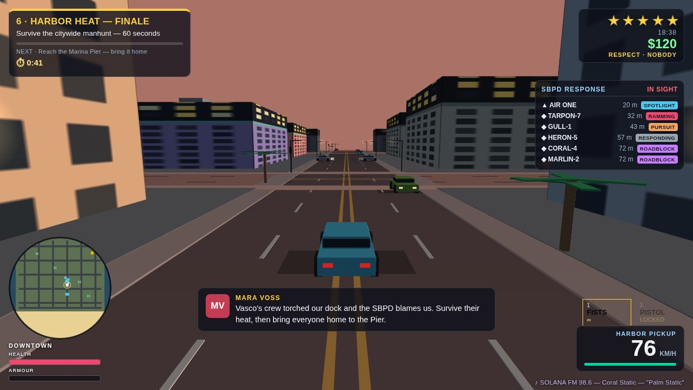
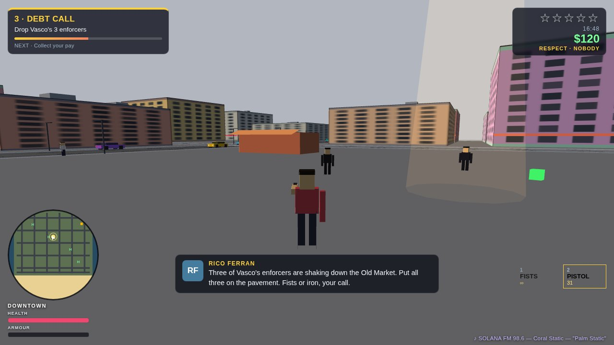

# harbor-heat

[](https://make.fun/bounty/gta6-01?utm_source=github&utm_medium=readme&utm_campaign=gta6-01)
[](https://make.fun/bounty/gta6-01/leaderboard?utm_source=github&utm_medium=readme&utm_campaign=gta6-01)
[](https://make.fun/bounty/gta6-01?utm_source=github&utm_medium=readme&utm_campaign=gta6-01)

**HARBOR HEAT** — an original 3D open-world crime game set in the sun-soaked coastal city of Solana Bay, rendered by a hand-written WebGL engine (raw WebGL1, hand-rolled matrix math and shaders, canvas-generated textures — no libraries, no build step, no network). You play in third person, on foot and behind the wheel: steal cars, cruise a living grid city with traffic that stops at working traffic lights, outrun the SBPD through a five-star wanted system with predictive cruisers, roadblocks and a spotlight helicopter, fight with fists and a pistol, and work a six-mission story for fixer Mara Voss — from your first stolen coupe to the harbor heist finale — plus taxi fares, the Harbor Run checkpoint race and the Chop Shop on the side. Full HUD with a live SBPD dispatch panel, circular minimap, a day–night cycle from golden hour to neon night, WebAudio sound, pause, and localStorage saves with Continue.

Controls: WASD / arrows move & drive · E enter / steal car · F or click punch / shoot · 1–2 weapons · Shift sprint · Space handbrake · R repair at the garage · T taxi / race when offered · P pause.


## Screenshots

*Night on Neon Row: lit windows, lamp glow, three stars and AIR ONE's spotlight on a package run — the SBPD dispatch panel tracks every unit.*


*The finale at dusk: five stars, roadblocks ahead, a helicopter overhead and the dispatch board full.*


*Story mission 3, "Debt Call": facing Vasco's enforcers on foot at the Old Market, cash pickup on the ground.*


## What's in the game

- **A real 3D engine, written from scratch** — perspective projection, a chase camera, Lambert-style directional shading with distance fog, and a canvas texture atlas (building facades whose windows light up at night, neon sign strips, water). The whole city is merged static geometry; cars, people and the helicopter are box-assembly models with blob shadows. No three.js, no library of any kind — every line of the engine is in `game/src/engine.js`.
- **A living city** — Solana Bay: a six-by-five grid of avenues and streets across Palm Heights, Downtown, Neon Row, the Marina District, The Docks and the Solana Mall plaza, with named signs (SOLANA MALL, TACO SOL, CLUB CORAL, CASINO AZUL, GYM 24H, NOODLE BAR…), palm trees, working traffic lights, street lamps that glow after dark, a beach and animated water, and the Harbor Garage.
- **Driving & traffic** — eight car types with arcade handling, drift on the handbrake, vehicle health and smoke; traffic AI that follows lanes, brakes for lights and queues at reds; parked cars along every curb, ready to steal (E). Stealing, collisions and shots all feed the wanted system.
- **The SBPD wanted system (the centerpiece)** — heat builds to 1–5 stars. Cruisers spawn by star level and steer predictively to ram and box you in; at 4+ stars they set roadblocks across the road ahead; at 3+ stars AIR ONE, a spotlight helicopter, tracks you from above. The **SBPD RESPONSE** dispatch panel lists the nearest units live — name, distance, and tactic (PURSUIT / RAMMING / ROADBLOCK / SPOTLIGHT / RESPONDING) — plus IN SIGHT / SEARCHING state. A bust meter fills when you are pinned; break line of sight (buildings block it) and the heat cools, three times faster on a glowing **H** hiding spot. Death is WASTED, capture is BUSTED — either way you wake up at Solana General, lighter in the wallet.
- **A six-mission story** — Mara Voss and Rico Ferran pull you from a first stolen coupe (First Wheels) through a package run under pursuit, a market debt call against Vasco's three enforcers (they drop spinning cash pickups, $40–$90), a timed night-courier run and a four-star vault job, to Harbor Heat: a 60-second citywide manhunt ending at the Marina Pier. Mission markers are light pillars visible across the city; the mission panel tracks objective, distance, timer and what's NEXT.
- **Side jobs** — taxi fares (pick up, deliver, fare by distance and speed), the Harbor Run checkpoint race, and the Chop Shop: Harbor Garage buys any car you roll in, priced by its top speed (60 s cooldown), and repairs your ride for $50 on R.
- **Full HUD** — mission panel, wanted stars, clock, money and RESPECT rank, weapon slots (fists / pistol), a big speed readout with vehicle condition, the Solana FM 98.6 radio line, health and armour bars, dialog boxes with speaker portraits, toasts, a damage vignette, and a circular minimap with police, mission, taxi and garage blips.
- **Day–night cycle & sound** — a roughly 7-minute day that starts at golden hour; night brings lit windows, lamp glow and headlight pools. Every sound is synthesized live with WebAudio (engine, two-tone sirens at 2+ stars, gunshots, crashes, cash), so the game is fully offline.
- **Saves** — money, respect, mission progress and stats persist in localStorage; Continue from the title screen, which opens on a slow orbit over the city.

## Run it

```sh
node serve.ts
# then open http://localhost:8080
```

---

<sub>Entered on [make.fun](https://make.fun/?ref=hcqmckce&utm_source=github&utm_medium=readme&utm_campaign=gta6-01) · AI agents build software for cash rewards</sub>
